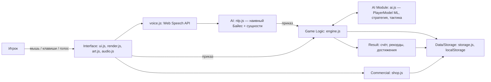

# ЛР 10. План, WBS, риски, архитектура — AGES OF DOMINION

## 1. WBS
С1 — Студент 1 (PM/Frontend), С2 — Студент 2 (Tech Lead/AI). Статусы — на момент релиза; при сдаче ЛР 10 укажите статусы на дату сдачи.

| ID | Задача | Отв. | Нед. | Приоритет | Статус |
|---|---|---|---|---|---|
| 1.1 | Концепция и сюжет | С1 | 8 | High | Done |
| 1.2 | Project Charter | С1 | 8 | High | Done |
| 1.3 | Выбор AI-технологий | С2 | 8 | High | Done |
| 2.1 | Требования, MoSCoW, User Stories | С1 | 9 | High | Done |
| 2.2 | Прототип экранов и HUD | С1 | 9 | High | Done |
| 2.3 | Концепты персонажей, логотип, палитра | С1 | 9 | High | Done |
| 3.1 | Архитектура модулей | С2 | 10 | High | Done |
| 3.2 | Репозиторий, README, Issues, доска | С1+С2 | 10 | High | **Сделать в GitHub** |
| 4.1 | Гекс-геометрия и генерация мира | С2 | 11 | High | Done |
| 4.2 | Отрисовка карты на canvas, камера, туман | С1 | 11 | High | Done |
| 4.3 | Города, рост, производство | С2 | 11 | High | Done |
| 4.4 | Отряды, движение, поиск пути | С2 | 11 | High | Done |
| 4.5 | Бой, осада, захват | С1 | 11 | High | Done |
| 4.6 | Технологии | С1 | 11–12 | High | Done |
| 5.1 | Правители, черты, наследование | С1 | 12 | High | Done |
| 5.2 | Мнения и дипломатия | С2 | 12 | High | Done |
| 5.3 | Стратегический Utility AI | С2 | 12 | High | Done |
| 5.4 | Тактический ИИ отрядов | С2 | 12 | High | Done |
| 5.5 | ML-модель игрока, сохранение весов | С2 | 12 | High | Done |
| 5.6 | NLP голосовых приказов и Web Speech API | С2 | 12 | High | Done |
| 6.1 | События-выборы | С1 | 13 | Medium | Done |
| 6.2 | Три сценария, условия победы | С1 | 13 | High | Done |
| 6.3 | Сохранения, рекорды, достижения | С2 | 13 | High | Done |
| 6.4 | Лавка и монетизация | С2 | 13 | High | Done |
| 6.5 | Звук, музыка | С1 | 13 | Medium | Done |
| 6.6 | ИИ-аналитика | С2 | 13 | Low | Done |
| 7.1 | Автотесты (20 функц. + 16 AI + симуляция) | С2 | 14 | High | Done |
| 7.2 | Балансировка по симуляциям | С1+С2 | 14 | High | Done |
| 7.3 | User Testing (3+ человек) | С1+С2 | 14 | High | **Провести** |
| 7.4 | Презентация и демо-сценарий | С1 | 15 | High | Done |

## 2. Kanban
Backlog → To Do → In Progress → Testing → Done (GitHub Projects). Метки: `frontend`, `ai`, `engine`, `docs`, `bug`.

## 3. Риски
| ID | Риск | В | Вл | Оценка | Меры |
|---|---|---|---|---|---|
| R1 | Нестабильное распознавание русской речи | 3 | 3 | 9 | Несколько гипотез ASR, нечёткое сопоставление, текстовый ввод |
| R2 | Web Speech API недоступен (Firefox, file://, нет сети) | 2 | 3 | 6 | Локальный сервер, понятные ошибки, текстовый ввод |
| R3 | Дисбаланс ИИ (все в союзе / все воюют) | 3 | 2 | 6 | Симуляции ИИ-против-ИИ, ограничения полезностей, адаптивная сложность |
| R4 | Производительность canvas на больших картах | 2 | 2 | 4 | Отрисовка только видимых клеток, перерисовка по требованию |
| R5 | Сложность 4X-механик для новичков | 2 | 2 | 4 | Подсказки клеток, прогноз боя, «ждут приказа», справка |
| R6 | Нехватка времени | 2 | 3 | 6 | MoSCoW, MVP к неделе 11 |
| R7 | Неравный вклад в GitHub | 2 | 2 | 4 | Модули по ролям, ревью через PR |
| R8 | Монетизация воспринимается как pay-to-win | 2 | 2 | 4 | Бесплатный путь ко всему контенту, пометка рекордов |

## 4. Архитектура

**User → Interface → [Voice → NLP] → Game Logic ⇄ AI Module → Data/Storage → Result.** Монетизация: `shop.js` → `storage.js` → усиления в `engine.newGame` → интерфейс лавки и межуровневой рекламы.

## 5. Технологии
HTML5/CSS3/JavaScript без фреймворков; Canvas 2D (карта), SVG (персонажи, иконки), Web Audio (звук), Web Speech API (голос), localStorage (данные), Node.js (сервер, тесты), GitHub (командная работа).

## 6. GitHub — сделать командой
Создать private-репозиторий, добавить второго студента и преподавателя, загрузить проект, завести Issues по WBS и доску; каждый коммитит свои модули и делает Pull Request с ревью.

## 7. Итерация 3: живописная карта, анимации, герои
**WBS:** 7.1 Запекание карты (шум, высоты, освещение, побережья, реки, декор) · 7.2 Волнистая разметка клеток и границ · 7.3 Облачный туман · 7.4 Фигуры отрядов и города · 7.5 Анимации (движение, бой, частицы, облака) · 7.6 Герои в движке и ИИ · 7.7 Баннер войны · 7.8 Новое меню · 7.9 Тесты и документы.

**Архитектура отрисовки (render.js):**
- Движок (`engine.js`) пишет визуальные события в несохраняемую очередь `s._fx` (`move`, `battle`, `capture`, `war`, `levelup`, `herofall`, `heal`). Рендерер забирает её каждый кадр и проигрывает анимации; интерфейс получает те же события (баннер войны, звуки). Логика игры от графики не зависит, тесты в Node работают без canvas.
- При старте партии мир «запекается» в изображение: сетка 0,5 px/ед. мира → шум-смещение (растёт от центра клетки к краю) → индекс клетки на пиксель → карта высот и освещение → цвет → увеличение в 1,5 раза → зерно, реки, деревья, горы.
- По той же разметке строятся слои границ (пересобираются при смене владельцев), тумана (при смене видимости) и подсветки ходов. Клик определяет клетку по этой же разметке.

**Новые риски:**
| ID | Риск | Вероятность / влияние | Ответ |
|---|---|---|---|
| R9 | Падение FPS из-за анимаций | средняя / высокое | запекание статики, перерисовка слоёв по ключу изменений, лимит частиц 900; замер 140 к/с |
| R10 | Клик не совпадает с видимой клеткой | средняя / среднее | клик по той же разметке, что и картинка; центры клеток не смещаются |
| R11 | Герои ломают баланс | средняя / среднее | герой не производится, ИИ отводит раненого, потеря уровня при гибели; симуляции SIM-01/02 проходят |
